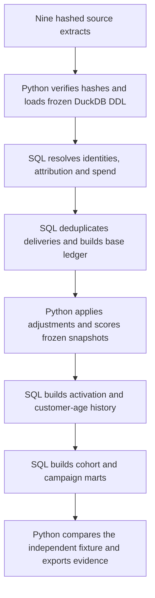

# Workstream C · Implemented DuckDB ELT

Implementation C-1.0.0 · [Specification Freeze v1.0](07_specification_freeze_v1.0.md)

## Dependencies and execution order



The packaged run executes the same transformations on the controlled fixture first, using primary, replay, pre-correction and post-correction recorded cutoffs. Full processing is gated on that comparison. Each run loads the frozen physical schema into a fresh local DuckDB connection. The bundle persists sorted Parquet tables with run IDs and reconciliation/exhibit extracts with a JSON run manifest.

## Source-to-output implementation

| Stage | Implementation and controls |
|---|---|
| Intake | Python verifies all nine compressed source hashes and source row counts from the v1.0 manifest, or the frozen fixture digest from D. Typed DuckDB ingestion enforces frozen constraints. Original records stay in their corresponding source tables during the run and in the source extracts afterward. |
| Point-in-time acquisition | SQL uses effective intervals and available identity versions to resolve each source registration. Missing or ambiguous signup identity enters the exception log. Visitor resolution is separate. Attribution selects the latest tracked eligible touch in [signup − 30 days, signup), with recorded availability through signup. Unknowns retain a reason. |
| Spend | SQL chooses the latest available campaign-day observation. Calendar allocation uses original spend month and does not depend on winning touches. Touch weighting uses winner counts, fallback to source month and largest-remainder penny assignment. Both retain zero-registration spend. |
| Ledger | SQL reports late and duplicate deliveries, excludes conflicting source keys, resolves account ownership, and maps the approved product and event codes to signed revenue or cost. Monetary inputs and accumulated results stay in cents. Interest uses the exact annual rate basis and half-up cents. Source-only cash/principal/face value movements remain inspectable. Python applies linked reductions in the approved order, enforcing available originals and cumulative caps. Restatements inherit effective time; recoveries and later reductions use their own. |
| Forecast | SQL selects eligible signup intent and preserves attribution and feature provenance in a snapshot hash. Python scores the fixed Workstream A parameters with exact half-up arithmetic. Both scenarios share one snapshot. Distinct versions and hashes preserve baseline. Report scenario timestamps distinguish acquisition as-of from run write cutoff. |
| Histories | SQL evaluates the 30/90/180/365 exclusive endpoints in UTC. A mature customer without activity has zero recognized amounts. A pending customer has null realized amounts. Late records can enter a later recorded snapshot without moving the effective boundary. |
| Cohorts | SQL aggregates customer money and forecast numerators before joining independently aggregated spend. A whole calendar month must have elapsed through its age horizon for realized comparison. Unknown and spend-only rows are retained. Spend-only CAC/ROAS are null. Revenue ROAS is evaluated at 90 days. Other age rows retain realized contribution/spend where mature. |
| Campaign days | SQL creates a campaign date spine with spend, registrations, mature activation, initial forecast, CAC and budget pacing. Pacing requires observed actuals and a complete positive cumulative plan. Null plans stay null. Monthly plan windows support daily monitoring; weekly summaries can be formed from daily supporting counts. |
| Exports | Python keeps run parameters, hash-checked source metadata, output hashes and row counts. Financial reconciliation ties each accepted base component to the signed ledger and adjustments. Separate audits reconcile each mature customer checkpoint and cohort, and each allocation method to campaign-day source spend. |

Use [the field dictionary](02_data_dictionary.md) and [the frozen mapping](02_source_target_mapping.md) for join keys and grain. In the export, `source_disposition.parquet` links raw delivery ID to disposition and ledger event, and `financial_event.parquet` carries canonical event IDs, timestamps and original event pointers. Rejoin the original source by `delivery_id` through `canonical_activity.parquet`. The compact worked example includes raw rate/basis and signed results side by side.

## Reproduce

From the project root, use Python 3.11+ with DuckDB 2.0.1 installed. Use a fresh output directory for comparison. Source extracts and D reference inputs are read-only inputs.

```sh
python3 src/ingest.py --controlled-only --output /tmp/mis636-controlled
python3 src/ingest.py --output /tmp/mis636-analytical
```

Primary full snapshot uses July 1, 2026 00:00 UTC as both exclusive effective cutoff and inclusive recorded cutoff. The controlled comparison report lists other recorded cutoffs explicitly. Parquet and CSV outputs are sorted for inspection. The manifest records the specific source and output hashes; physical file hashes can vary with DuckDB release or encoding options. The charged-off principal convention is realized loss with subsequent recoveries. It is a simplified synthetic design.

## Evidence for D and E

| Purpose | Extract |
|---|---|
| Controlled reference comparison | controlled_comparison.json |
| Source-to-ledger trace and worked customer | source_disposition.parquet, financial_event.parquet, worked_customer_trace.csv and worked_customer_summary.csv |
| Actual versus expected by cohort age | channel_cohort.parquet, cohort_comparison.csv and scenario_comparison.csv |
| Spend-allocation sensitivity | allocation_comparison.csv and spend_allocation.parquet |
| Operational monitoring | campaign_performance_day.parquet and campaign_monitoring.csv |
| Reconciliation | financial_reconciliation.csv, history_reconciliation.csv, cohort_reconciliation.csv, marketing_reconciliation.csv and pipeline_manifest.json |

The production design remains a daily batch warehouse/SQL/dbt approach with retained source snapshots and BI delivery, as contrasted with Assignment 1. This is a local DuckDB and static extract implementation. Production change capture, access controls, warehouse performance, and causal attribution remain outside the evidence. The C-side comparisons are implementation checks against D’s independent expectations. D Stage 2 still owns independent review of the observed evidence, exception handling and architecture claims.

## Executed results and D Stage 2 handoff

The controlled run recorded 329 matching reference comparisons across four snapshots, with zero discrepancies. Daily CAC cases with a missing spend numerator were compared using their original numerator/denominator records and retain an unavailable displayed ratio. The frozen fixture and D reference remained byte-identical.

The full primary snapshot produced 827,038 financial components across all five products. All-visible synthetic ledger revenue was 217,071,013 cents, costs were 124,463,372 cents, and contribution was 92,607,641 cents. These totals include eligible activity across the visible history, including activity outside the four age windows. Source-to-ledger, mature history and cohort financial checks reported zero differences. Both allocation methods tie to 33,067,679 eligible source cents with zero campaign-day differences. The 90-day worked-customer trace for C02703 sums to 32,171 contribution cents and matches its customer-age output.

D should verify the observed fixture rows, trace the linked fee and recovery at their cutoffs, check spend and ledger reconciliation and verify frozen forecasts across snapshots. The fixture and full extract do not exercise conflicting financial-delivery payloads, malformed operational refund references, invalidated deposits or funding with an explicit reversal link, or every inventory status. Operational activation currently covers the supplied qualifying event codes and settled purchase refunds. Coverage of invalid operational adjustment patterns requires additional reviewed cases before extending claims. The prototype exports daily campaign evidence; weekly action queues and slide construction belong to reporting. No production performance or causal claim follows from the channel comparisons.

## C-1.0.1 operational refund correction

After canonical activity deduplication and before activation, the Python runner resolves operational refunds against an accepted original purchase in the same run. The original purchase and refund must be settled and share the same account and customer. Refund effective time must follow the original, and its recorded timestamp cannot predate the original's availability. Accepted deductions are ordered by effective time, recorded time, source key and delivery ID. A refund above the remaining purchase balance is rejected in full. The existing exception vocabulary is reused with a specific refund diagnostic in the detail field. Activation SQL consumes only the accepted refund table. Economic adjustments and financial-event recognition remain separate.

Run `python3 tests/refund_link_regressions.py --output /tmp/mis636-refund-results.json` for the original malformed probe and nine additional cases. Keep the independent expected JSON and the frozen controlled fixture as separate, unchanged inputs.
