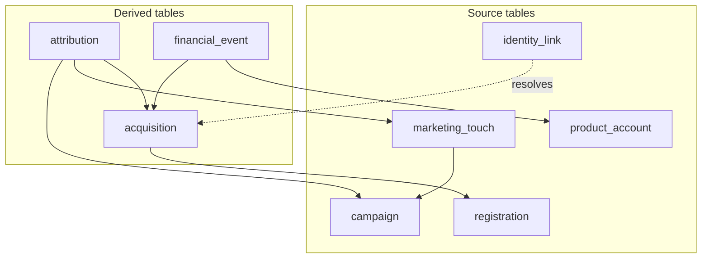
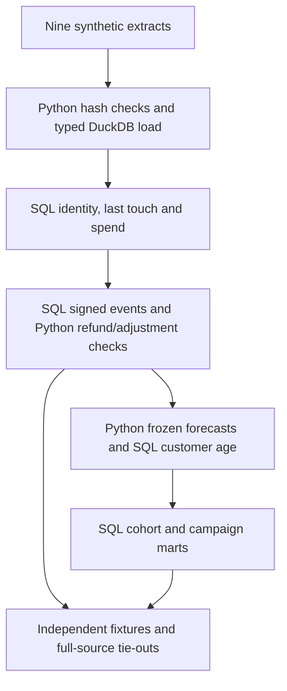

# Slide 03 and 04 visual specifications

Use matching source and derived colors across both slides. Solid arrows below are declared DDL foreign keys drawn from dependent tables to their referenced parents. Dashed arrows show lineage through transformations. Read from parent tables toward outputs when presenting the data flow.

## Slide 03 · Physical structure

`financial_event` also links to `canonical_activity` by `(run_id, source_key)`. Resolve `product_account.owner_identity` through the identity process. The physical schema keeps raw activity deliveries and canonical components as separate grains.

| Selected table and grain | Actual schema excerpt |
|---|---|
| `acquisition` · canonical customer | `customer_id VARCHAR` PK, `registration_id VARCHAR` unique FK to `registration`, `registration_at TIMESTAMPTZ`, `signup_month DATE` |
| `financial_event` · component × run | `(run_id VARCHAR, event_id VARCHAR)` PK, `account_id VARCHAR` FK to `product_account`, `customer_id VARCHAR` FK to `acquisition`, `signed_cents BIGINT`, `effective_at TIMESTAMPTZ`, `recorded_at TIMESTAMPTZ` |

### Appendix A inventory

| Group | Physical tables |
|---|---|
| Source · 9 | campaign, campaign_day, campaign_budget, registration, identity_link, marketing_touch, registration_feature, product_account, product_activity_delivery |
| Run, identity and ledger · 7 | run_manifest, exception_log, acquisition, attribution, canonical_activity, financial_event, activation |
| Forecast and reporting · 8 | feature_snapshot, forecast_model, prediction, prediction_age, spend_allocation, customer_age, channel_cohort, campaign_performance_day |

See [DDL](../../src/schema.sql), [dictionary](../../docs/02_data_dictionary.md) and [logical ERD](logical_erd.md) for types, grain and full keys.

## Slide 04 · Executed ELT and proposed boundary

Attach separate labels for simulated 30-day last touch in the implemented branch and **proposed** MMP API attribution ingestion in production. Joining vendor attribution to internal identifiers requires validation of windows, freshness and coverage. No live MMP connection was built. The prototype uses local DuckDB and static exhibits. A production warehouse/SQL/dbt implementation and live BI delivery remain proposed.

Sources: [Pipeline implementation](../../docs/03_pipeline_design.md), [mapping](../../docs/02_source_target_mapping.md), [run manifest](../../data/analytical_outputs/pipeline_manifest.json).
