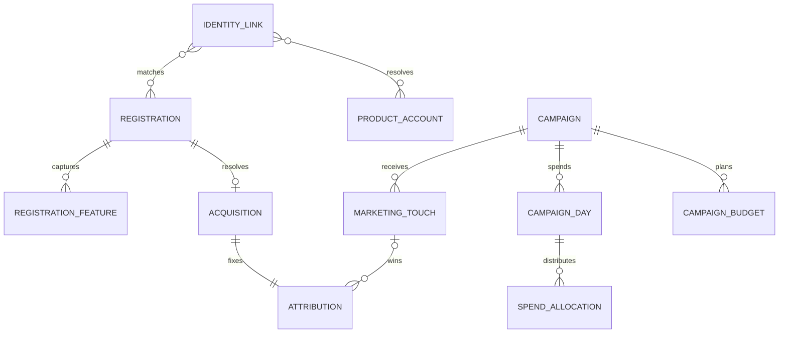
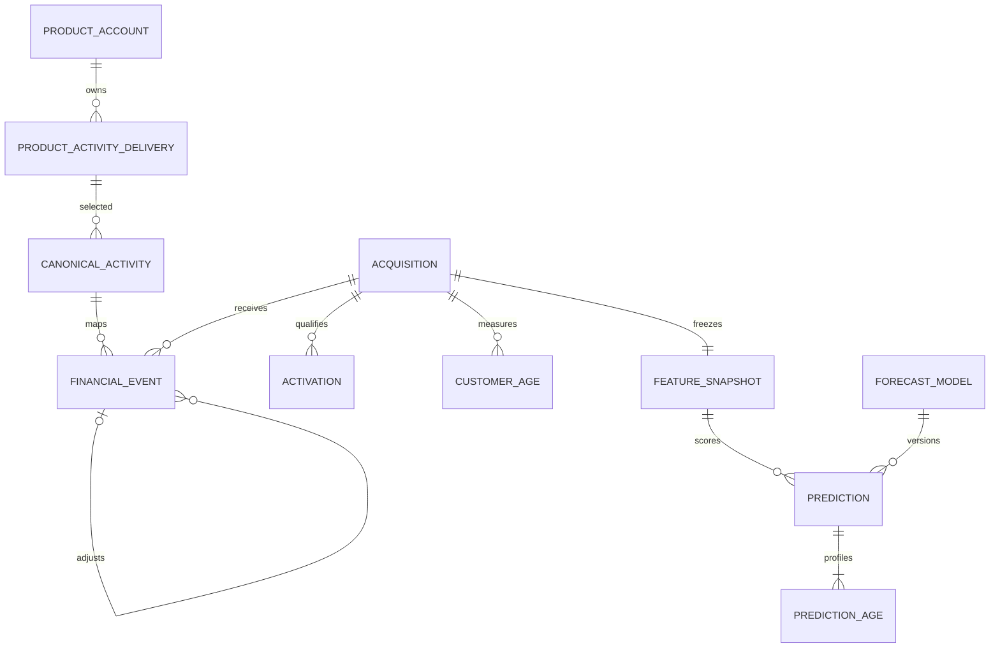

# Logical entity relationships

Customer-age rows, attribution, forecast trajectories and spend allocations aggregate independently before the channel cohort join. Campaign performance combines daily spend and applicable budget plans with daily signup attribution and customer-level activation. The run manifest scopes ledger and reporting relations, while exception rows retain source identifiers. Physical keys and join constraints live in the data contract.
