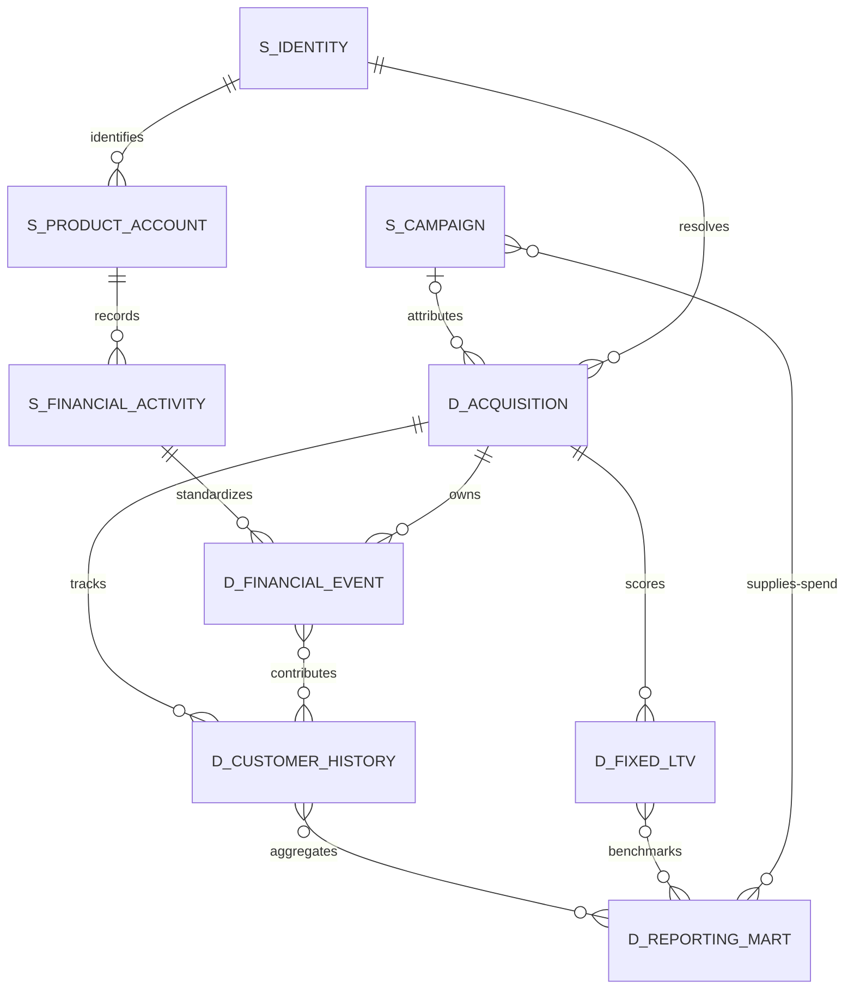

# Acquisition and customer value · simplified ER diagram

**S** marks a source entity and **D** marks a derived entity. The acquisition entity includes attribution and the campaign group includes marketing touches, spend and plans. The financial-event link to history represents effective-date aggregation across checkpoints. Reporting marts are cohort and campaign aggregates. The [detailed logical ER diagrams](logical_erd.md) show the physical lineage behind these groupings.
