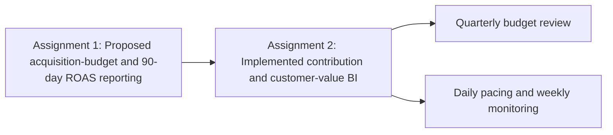
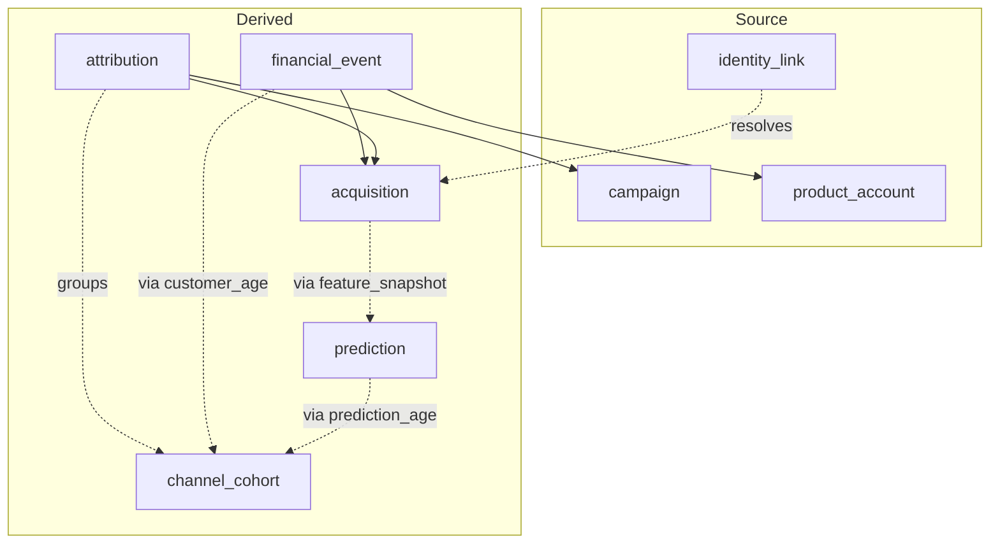
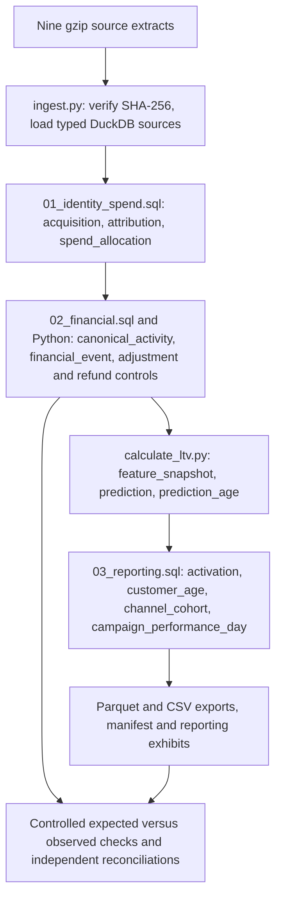
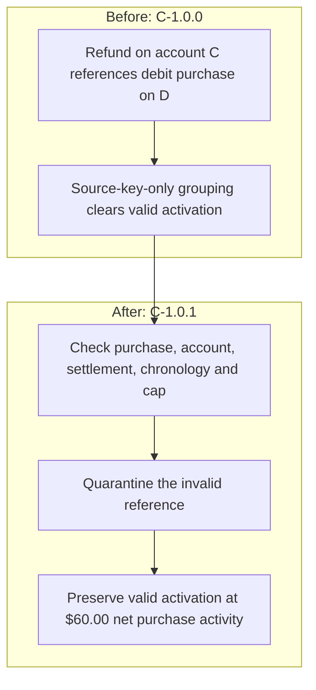

# Main-deck visual kit

Use the editable Mermaid diagrams and tables as construction masters. The [trajectory chart](customer_age_trajectory.svg) is a vector export backed by the [four source values](../../data/analytical_outputs/worked_customer_summary.csv). The dashboard wireframes open offline in a browser. All quantitative examples are synthetic.

## 01 · Alignment

## 02 · Source grains and representative records

| Source family | Implemented grain examples |
|---|---|
| Acquisition and budgets | Timestamped registrations and touches. Campaign-day spend and plan records. |
| Ownership | Source identity claims with elapsed validity and recorded time. One product account per account key. |
| Finance | Each delivery carries its account, source event, activity code and two timestamps. |

| Table | Selected actual fields |
|---|---|
| `registration` | `registration_id=R02703`, `registration_identity=reg:02703` |
| `product_account` | `account_id=A027030`, `owner_identity=reg:02703`, `product=SAVINGS` |
| `product_activity_delivery` | `delivery_id=D00457542`, `source_key=core:E00457542`, `account_id=A027030`, `activity_code=SAV_TREASURY_INCOME`, `amount_cents=104900` |

Controlled signup R1 is March 1, 2025, 00:00 UTC. The selected T02 occurred and was recorded February 26. T03 occurred February 28 but was recorded March 2, after signup.

## 03 · Eight-table relationship excerpt

Solid arrows are declared FKs from referencing to referenced table. Dashed arrows show transformation lineage, including intermediate tables omitted from the view.

| Table and grain | Typed excerpt |
|---|---|
| `acquisition` · one row per canonical customer | `customer_id VARCHAR` PK, `registration_id VARCHAR` unique FK to `registration`, `registration_at TIMESTAMPTZ`, `signup_month DATE` |
| `financial_event` · one component per run | PK `(run_id VARCHAR, event_id VARCHAR)`. `account_id VARCHAR` FK → `product_account`. `customer_id VARCHAR` FK → `acquisition`. `(run_id, source_key)` FK → `canonical_activity`. `signed_cents BIGINT`, `effective_at TIMESTAMPTZ`, `recorded_at TIMESTAMPTZ`. |

## 04 · Executed pipeline

Keep the production proposal outside this flow. Show MMP API, live product feeds, external budgets, warehouse and BI as planned integration points.

## 05 · Source-to-customer bridge

| Step | Actual value |
|---|---|
| Savings source | `core:E00457542` · 104,900 cents × 0.073 ÷ 365 |
| Canonical event | `core:E00457542/SAV_TREASURY_INCOME` · 21 revenue cents |
| Customer age 90 | 479 components · $1,348.67 revenue − $1,026.96 costs = **$321.71 contribution** |
| Cohort output | C02703 contributes $321.71 to the 36-customer March 2025 unknown-attribution group. |

## 06 · Same-age results and historical comparison

| C02703 age | 30d | 90d | 180d | 365d |
|---|---:|---:|---:|---:|
| Fixed expected contribution | $2.26 | $9.62 | $22.69 | $51.30 |
| Realized contribution | $15.01 | $321.71 | $1,150.61 | $2,771.21 |

| Same filters, 90-day mature cohorts | March 2025 | September 2025 |
|---|---:|---:|
| Paid attribution coverage, all channels | 257/293 | 227/256 |
| Google Ads example, mature n | 86 | 82 |
| Calendar eligible spend | $6,218.43 | $5,990.43 |
| CAC | $72.31 | $73.05 |
| Revenue ROAS | 2.29× | 0.60× |
| Realized contribution / eligible spend | 1.05× | 0.27× |

These columns demonstrate the same aggregation and denominator rules across two periods. They are not a simulated performance verdict.

## 07 · Dashboard extracts

**[Strategic wireframe](strategic_dashboard_extract.html).** Use [cohort evolution](customer_cohort_evolution.svg) with its March/September mature counts. The [channel efficiency chart](channel_efficiency_comparison.svg) is available as supporting evidence. Keep maturity, coverage and method labels alongside paid metrics. Use the whole-history product panel only in the appendix.

**[Operational wireframe](operational_dashboard_extract.html).** Highlight F1 June 1–7, 2026 with [daily spend versus plan](campaign_daily_spend.svg) and [activation maturity](campaign_activation_maturity.svg). The [chart mapping](dashboard_chart_sources.md) lists cumulative spend, registrations and CAC extracts. Use these rows if embedding an offline table.

| F1 UTC date | Actual spend | Planned spend | Signups | Interpretation |
|---|---:|---:|---:|---|
| Jun 02 | $124.00 | $100.00 | 0 | Spend remains visible. Daily CAC unavailable. |
| Jun 04 | $97.77 | Unavailable | 3 | Cumulative pacing unavailable. 30-day activation pending, 0 mature of 3. |

June 4 actual month-to-date spend is $400.94. The source campaign-day mart also carries an initial forecast total and operational status fields. Show campaign drilldown to daily spend, plan coverage and acquisition quality.

## 08 · Validation scorecard

| Test family | Result | Establishes |
|---|---|---|
| Frozen controlled cases | 329/329 matches | Identity, signed events, cutoff and maturity behavior agree with expected results. |
| Refund regressions | 10/10 passed | Invalid operational links are excluded. Valid refunds retain their intended effects. |
| Reproduction | 26/26 files | Same source inputs and run settings reproduce outputs. |
| Independent finance | $2,170,710.13 − $1,244,633.72 = $926,076.41 | Source costs and revenue tie to visible ledger contribution. |
| Independent marketing | $330,676.79 under each method | Calendar and touch weighting conserve eligible spend. |

## 09 · Operational defect and correction

| Decision | Evidence to display |
|---|---|
| Retain source-level ELT | Original deliveries, duplicate treatment and late-record replay are inspectable. |
| Preserve canonical events | Signed components with source keys reconcile to customer and cohort. |
| Daily batch cadence | Supports the stated daily and weekly decisions in the local prototype. |

## 10 · Handoff visual

Use three outcome cards for integrated sources, traceable analytical outputs, and independently tested refinement. Below them, show the frozen inputs, run cutoffs, tests and marts under “Assignment 3 baseline.” Place remaining production and untested requirements in a compact footer.
